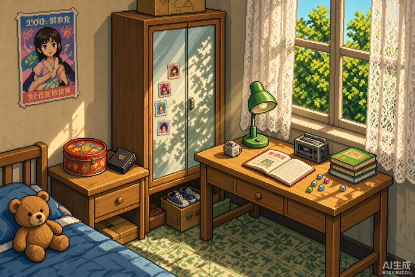
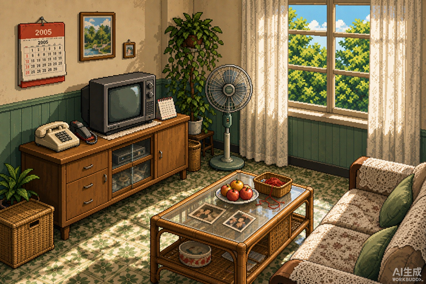
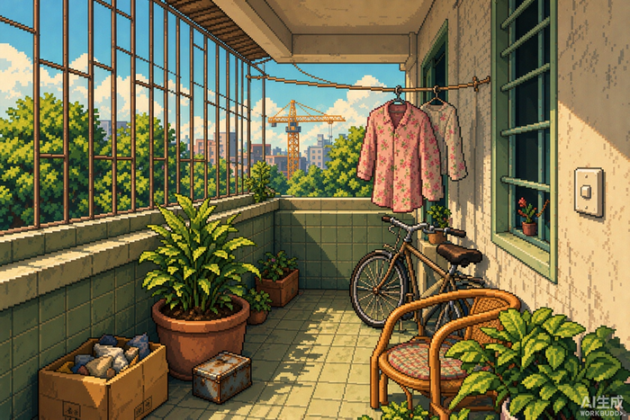

# 千禧年的房间 · The Room of the Millennium

一款绣湖（Rusty Lake）风格的**点击式解谜小游戏**，用纯 HTML + SVG 手绘做的，不用任何引擎。

> 2000 年前后的一个下午，你醒在一间租来的老房子里。
> 挂钟停在四点整，日记本翻开着，妈妈在床底下藏了点什么。

## 在线玩

👉 **[点击开始游戏](https://YOUR-USERNAME.github.io/YOUR-REPO/)**

（把上面两个 `YOUR-...` 换成你自己的 GitHub 用户名和仓库名）

## 截图

| 卧室 | 客厅 | 阳台 |
|---|---|---|
|  |  |  |

## 怎么玩

- 左右箭头切换房间，左下角箭头逐级退回
- **每个地方都要点两下**：第一下放大到台面 / 柜面，第二下才放大到那件东西
- 点物品栏选中道具，再点目标使用；点空白处放下道具
- 单线谜题，顺序错了就进行不下去

## 特点

- **单文件自包含**：所有图片以 base64 内联，`index.html` 一个文件就能跑，双击即玩
- **双美术风格**：像素风（日记本 / 鞋柜 / 密码盒 / 小铁盒）+ 贴纸风（台灯 / 饼干盒 / 床底 / 抽屉内景）
- **两级放大交互**：房间 → 台面特写 → 单品特写
- **WebAudio 合成音效**：切房间、开箱、开不了、拿取、密码键、解锁成功，全部实时合成，没有音频文件
- 13 步严格线性谜题链，一环扣一环

## 技术

纯前端，零依赖。

- 渲染：内联 SVG（像素风用 8px 网格绘制，贴纸风用路径 / 椭圆）
- 音效：WebAudio API 实时合成
- 图片：PNG → base64 内联进 HTML

## 本地运行

直接双击 `index.html` 就行。或者起个本地服务：

```bash
python -m http.server 8000
# 打开 http://localhost:8000
```

---

Made with ♥ · 一个关于长大以后的房间的梦
